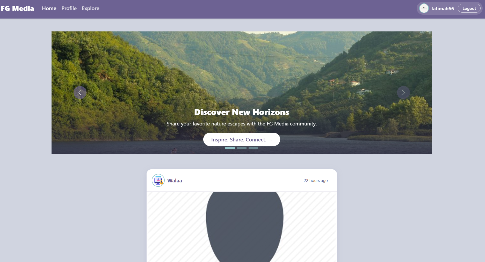
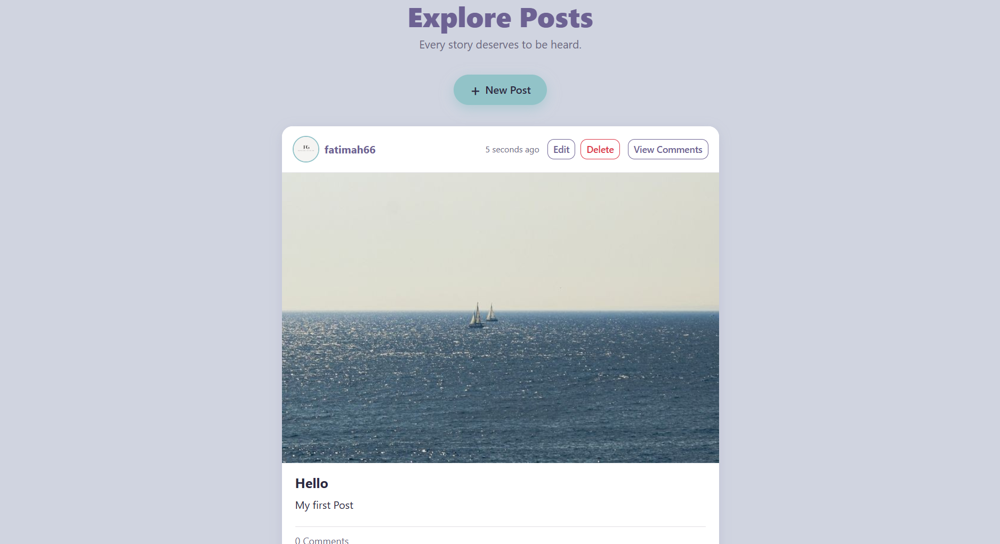
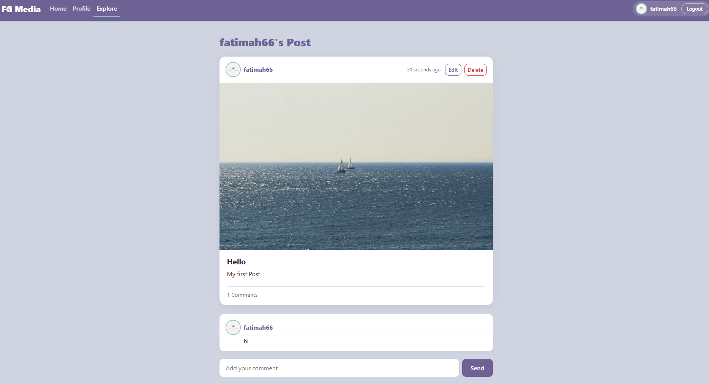
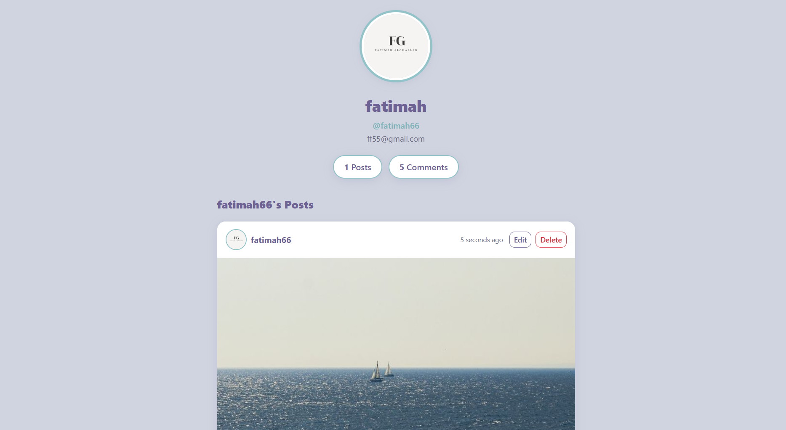
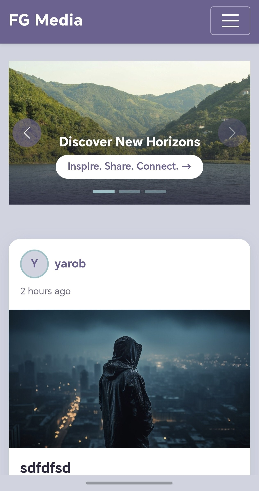

# FG Media

A responsive social media web app where users can register, share posts with images, explore what others have posted, and join the conversation through comments.

Built as the final project for the **Advanced JavaScript** course by **Tarmeez Academy**.

## Features

- **Authentication**: register (with an optional profile image), log in, and log out. The session is kept using a token stored in `localStorage`.
- **Home page**: hero carousel and a preview of the latest posts.
- **Explore page**: browse all posts with infinite scroll (posts load automatically as you scroll).
- **Create, edit and delete posts**: add a title, text and an optional image. Only the author can edit or delete their own posts.
- **Post details**: view a single post together with its comments, and add a new comment when logged in.
- **User profile**: shows the user's info, number of posts, number of comments, and all of their posts. Clicking a username or the avatar in the navbar opens the profile.
- **Instant feedback**: success and error alerts for every action.
- **Responsive design**: works on phones, tablets and desktops.

## Live Demo

🔗 [https://fatimahghallab2-boop.github.io/fg-media/](https://fatimahghallab2-boop.github.io/fg-media/)
## Screenshots

### Home


### Explore


### Post Details


### Profile


### Mobile


## Built With

- HTML5
- CSS3 (custom styling on top of Bootstrap)
- [Bootstrap 5.0.2](https://getbootstrap.com/)
- JavaScript (vanilla, ES6+)
- [Axios](https://axios-http.com/) for API requests
- REST API provided by **Tarmeez Academy**

## Project Structure

```
├── index.html          # Home page (carousel + latest posts)
├── posts.html          # Explore page (all posts + create post)
├── post_details.html   # Single post with comments
├── profile.html        # User profile page
├── style.css           # Custom styles
├── config.js           # API endpoints
├── script.js           # Login, register, logout, navbar UI and alerts
├── posts.js            # Posts, comments, pagination, create/edit/delete
├── profile.js          # Profile page logic
└── p1.jpg, p2.jpg, p3.jpg   # Carousel images
```

## Getting Started

1. Clone or download the repository.
2. The API endpoints (provided by Tarmeez Academy) are defined in `config.js`.
3. Open the project with a local server, for example the **Live Server** extension in VS Code (right click `index.html` and choose *Open with Live Server*).

No build step or installation is needed. Bootstrap and Axios are loaded from a CDN, so an internet connection is required.

## Design

Color palette used across the site:

| Color | Hex | Usage |
|-------|-----|-------|
| Lavender grey | `#D0D4E0` | Page background |
| Purple | `#6D6293` | Navbar, headings, buttons |
| White | `#FFFFFF` | Cards and modals |
| Teal | `#92C3C8` | Accents and highlights |

## Author

Fatimah ALGhalllab
